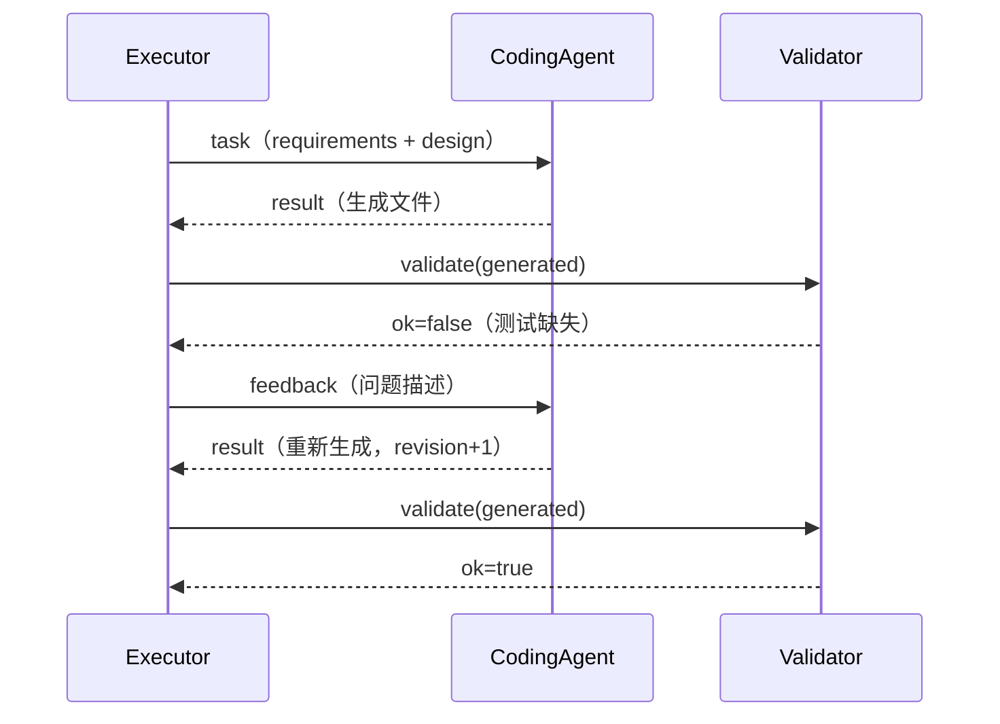

# Mini SE Workflow 设计文档

- 版本：1.0
- 对应作业：SE2026 Homework 2 —— Simple Workflow MVP
- 技术栈：Python 3.9+，仅标准库

---

## 1. 目标与范围

### 1.1 目标

用 2～3 个 Agent 串起一条完整的 Mini SE 流程（需求 → 设计 → 编码），
验证 Workflow 编排、Agent 间通信、状态管理三项核心能力，并保证 MVP 可运行、可演示、可扩展。

### 1.2 范围

包含：

- 顺序执行的三 Agent 流程
- JSON 声明式流程定义
- 消息传递与共享状态
- 质量校验节点、失败反馈与修订循环
- 事件日志、状态快照、运行报告

不包含：

- 图形化编排界面
- 真实大模型调用（接口已预留）
- 并行执行、分布式调度
- 多用户与持久化数据库

## 2. 总体架构

```text
┌──────────────────────────────────────────────────────────┐
│                        run.py（入口）                     │
│        参数解析 / 清理旧产物 / 组装依赖 / 退出码           │
└───────────────────────────┬──────────────────────────────┘
                            │
┌───────────────────────────▼──────────────────────────────┐
│                     Executor（编排层）                    │
│   顺序调度 / 节点重试 / 条件回退 / 修订轮数 / 报告生成      │
└───────┬───────────────────────────────┬──────────────────┘
        │ task / feedback 消息           │ validate
┌───────▼───────────────┐       ┌───────▼──────────────────┐
│   Agent 层（3 个）     │       │   Validator 层            │
│ RequirementAgent      │       │ python_quality           │
│ DesignAgent           │       │ 编译 + 单测 + 用例数       │
│ CodingAgent           │       └──────────────────────────┘
└───────┬───────────────┘
        │ 读写产物
┌───────▼──────────────────────────────────────────────────┐
│                  WorkflowState（状态层）                  │
│ artifacts / messages / node_status / shared / revision   │
└───────┬──────────────────────────────────────────────────┘
        │
┌───────▼──────────────────────────────────────────────────┐
│                 EventLogger（可观测层）                    │
│ 控制台输出 / events.jsonl / state.json / report.md        │
└──────────────────────────────────────────────────────────┘
```

分层原则：Executor 只认识“Agent 名字”和“校验器名字”，通过注册表解耦具体实现；
Agent 只通过 `WorkflowState` 与 `Message` 交互，不感知流程位置。

## 3. 模块职责

| 模块 | 职责 | 关键接口 |
|------|------|----------|
| `run.py` | CLI 入口，组装 State/Logger/Executor | `main() -> int` |
| `mini_se/executor.py` | 解释流程定义、调度节点、处理失败与回退、写报告 | `Executor.run()` |
| `mini_se/state.py` | 共享状态与产物登记 | `publish()` / `register_artifact()` |
| `mini_se/message.py` | 消息数据结构与序列化 | `Message.to_dict()` |
| `mini_se/logger.py` | 双写日志与控制台格式化 | `EventLogger.event()` |
| `mini_se/validators.py` | 质量校验实现与注册表 | `python_quality()` / `VALIDATORS` |
| `mini_se/agents/base.py` | Agent 抽象与统一结果 | `BaseAgent.handle()` / `AgentResult` |
| `mini_se/agents/*` | 三个具体 Agent | 见下表 |

## 4. Agent 设计

| Agent | 输入 | 输出（artifact key） | 关键逻辑 |
|-------|------|----------------------|----------|
| RequirementAgent | `brief` | `requirements` | 解析一级标题；按小节收集功能点，跳过“约束/非功能/范围外”；生成 FR 编号、P0/P1、AC 验收项；识别项目类型写入 `shared` |
| DesignAgent | `requirements` | `design` | 依据项目类型输出分层架构、模块表、Task 数据模型、命令接口、关键流程、测试策略 |
| CodingAgent | `requirements` + `design` | `generated_app` / `generated_tests` / `generated_readme` | 校验上游产物存在后，按模板生成 `app.py`、`test_app.py`、`README.md`；读取最新 `feedback` 并在 README 写入修订记录 |

统一返回结构：

```python
@dataclass
class AgentResult:
    content: str                     # 写给下游/日志的结果摘要
    artifacts: Dict[str, Path]       # 产物 key -> 文件路径
    meta: Dict[str, Any]             # 节点附加信息
```

## 5. 通信协议

### 5.1 消息类型

| 类型 | 方向 | 用途 |
|------|------|------|
| `task` | executor → agent | 下发节点任务，携带输入 artifact key |
| `result` | agent → executor | 返回结果摘要与产物 key |
| `feedback` | executor → agent | 校验失败时下发问题，触发修订 |

### 5.2 消息示例

```json
{
  "id": "9f3c1a2b",
  "sender": "coding",
  "receiver": "executor",
  "type": "result",
  "content": "生成待办应用 4 个文件，第 1 轮修订",
  "artifacts": ["generated_app", "generated_tests", "generated_readme"],
  "meta": {"node": "coding", "revision": 1, "feedback": true},
  "created_at": "2026-10-25 21:18:56"
}
```

设计取舍：消息正文只放摘要，大文本放产物文件，避免日志膨胀；
产物通过 key 引用，Agent 之间不传绝对路径。

## 6. 状态管理

`WorkflowState` 字段：

| 字段 | 类型 | 说明 |
|------|------|------|
| `artifacts` | `Dict[str, Path]` | 产物登记表，下游按 key 读取 |
| `messages` | `List[Message]` | 完整消息流水 |
| `node_status` | `Dict[str, dict]` | 状态、尝试次数、耗时、错误/校验详情 |
| `shared` | `Dict[str, Any]` | 运行期上下文，如 `project_kind` |
| `revision` | `int` | 当前修订轮次 |

状态一律由 Executor 写入，Agent 只读上游产物并向 Executor 返回结果，避免多节点并发写冲突。
每次运行结束输出 `state.json`，可完整回放一次执行。

## 7. 流程控制

### 7.1 流程定义

```json
{
  "name": "Mini SE Workflow",
  "steps": [
    {"id": "requirements", "type": "agent", "agent": "requirement", "inputs": ["brief"]},
    {"id": "design", "type": "agent", "agent": "design", "inputs": ["requirements"]},
    {"id": "coding", "type": "agent", "agent": "coding",
     "inputs": ["requirements", "design"], "retry": 1},
    {"id": "validate", "type": "validate", "validator": "python_quality",
     "on_fail": {"goto": "coding", "max_loops": 2}}
  ]
}
```

### 7.2 控制语义

| 能力 | 实现 |
|------|------|
| 顺序执行 | 按 `steps` 下标推进，Agent 完成后 `index + 1` |
| 节点重试 | `retry` 次数内捕获异常并重新执行，记录 WARN 事件 |
| 条件分支 | 校验失败且配置了 `on_fail.goto`，跳转到目标节点下标 |
| 循环修订 | `max_loops` 限制同一校验节点的回退次数；`state.revision` 自增 |
| 死循环保护 | 单次运行最多 100 步，超过即抛 `WorkflowError` |
| 失败可观测 | 任意异常都会写失败报告与状态快照，再向上抛出 |

### 7.3 修订时序



## 8. 校验设计

`python_quality` 分三层：

1. **编译**：对 `generated/*.py` 执行 `py_compile`，捕获语法错误
2. **用例数量**：`test_app.py` 中 `def test_` 不少于 3 个
3. **真实执行**：在生成目录运行 `python -m unittest -v test_app`，超时 60s

任何一层失败都会返回可读的 `detail`，由 Executor 转成 `feedback` 消息。
校验器与流程解耦，新增规则只需写函数并注册。

## 9. 错误处理与恢复

| 场景 | 处理 |
|------|------|
| Agent 临时异常 | 按 `retry` 重试，成功后继续 |
| Agent 最终失败 | 节点标记 `failed`，流程终止，退出码 1 |
| 校验失败 | 回退到 `goto` 节点，携带反馈修订 |
| 修订超过上限 | 流程终止并保留失败报告 |
| 上游产物缺失 | Agent 抛 `FileNotFoundError`，由执行器捕获 |
| 数据文件损坏（生成的待办应用） | 返回空列表，降级不崩溃 |

## 10. 可扩展性设计

1. **新增 Agent**：继承 `BaseAgent`，实现 `handle()`，在 `build_agents()` 注册，
   在 `workflow.json` 增加节点即可，执行器零改动。
2. **新增校验器**：在 `validators.py` 实现函数并加入 `VALIDATORS`。
3. **调整流程**：只改 JSON，可插入审查、测试、文档等节点。
4. **接入 LLM**：保持 `handle()` 输入输出不变，将模板生成替换为模型调用；
   校验与日志机制继续复用。
5. **并行执行（后续）**：`Executor` 的节点调度已与具体 Agent 解耦，
   可在步骤声明中增加 `parallel` 分组，用线程池并发执行互不依赖的节点。

## 11. 设计取舍

| 决策 | 理由 |
|------|------|
| 确定性模板 Agent 而非在线 LLM | 作业要求 MVP 可运行；离线、无密钥、可复现，便于助教一键验证 |
| 产物落文件而非只放内存 | 便于人工检查、Git 留痕与演示；消息只传摘要避免日志过大 |
| Executor 单点写状态 | 结构简单、无并发写冲突；符合 MVP 定位 |
| 校验节点独立于 Agent | 质量门禁可复用、可组合，流程定义更清晰 |
| 流程 JSON 化 | 满足“架构支持新增 Agent、修改流程”的可扩展性评分 |

## 12. 验证记录

| 项目 | 结果 |
|------|------|
| 端到端运行 | `py -3 run.py` 成功，耗时约 0.3s |
| 生成应用 | `add/list/done/stats` 均正常，非法 ID 返回码 2 |
| 生成应用单测 | 6 个用例全部通过 |
| 引擎测试 | 3 个用例通过（修订循环、重试恢复、端到端） |
| 修订循环 | 模拟校验失败后成功回退并记录 feedback 消息 |
| 日志 | `events.jsonl`、`state.json`、`report.md` 均生成 |

## 13. 后续演进

- 支持并行节点与 DAG 依赖
- 接入真实 LLM Agent，并保留确定性校验门禁
- 增加 Web 可视化编排与运行状态面板
- 加入人工审批节点（Human-in-the-loop）
