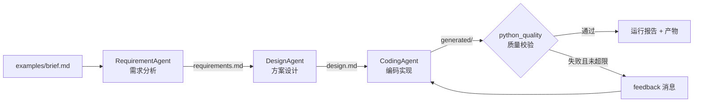

# Mini SE Workflow（Homework 2）

一个可运行、可扩展的最小 Agent 工作流：**需求分析 → 方案设计 → 编码实现 → 质量校验**。
三个 Agent 通过消息协作、共享状态，校验失败会自动回退到编码节点修订。

- 零第三方依赖，Python 3.9+ 标准库即可运行
- 流程由 `workflow.json` 声明，Agent 与校验器均可插拔
- 每次运行产出需求文档、设计文档、可运行的待办应用与完整日志

---

## 1. 快速开始

```bash
# Windows（本机已安装 Python 3.14，可用 py -3 指定版本）
py -3 run.py

# macOS / Linux 或已配置 python3
python3 run.py
```

一条命令结束后会得到：

```text
workspace/
├─ requirements.md        # 需求分析 Agent 产出
├─ design.md              # 设计 Agent 产出
└─ generated/             # 编码 Agent 产出（可直接运行）
   ├─ app.py
   ├─ test_app.py
   └─ README.md

logs/<run_id>/
├─ events.jsonl           # 结构化事件日志
├─ state.json             # 本次运行的状态快照
└─ report.md              # 可读运行报告
```

控制台输出示例：

```text
[2026-10-25 21:18:56] [====] 工作流启动: Mini SE Workflow (run_id=20261025-211856-0956)
[2026-10-25 21:18:56] [MSG ] executor -> requirement (task): [需求分析] 请处理输入: - 原始需求(brief)
[2026-10-25 21:18:56] [RUN ] requirements - 需求分析
[2026-10-25 21:18:56] [MSG ] requirement -> executor (result): 完成需求分析：7 条功能需求，项目类型=todo
[2026-10-25 21:18:56] [OK  ] requirements (0.00s, attempt 1)
...
[2026-10-25 21:18:56] [PASS] validate: 编译通过，6 个测试全部通过
[2026-10-25 21:18:56] [====] 工作流结束: success，耗时 0.29s
```

实验生成的待办应用：

```bash
py -3 workspace/generated/app.py add "体验 Mini SE Workflow"
py -3 workspace/generated/app.py list
py -3 workspace/generated/app.py done 1
py -3 workspace/generated/app.py stats
```

## 2. 工作流与 Agent 分工



| Agent | 输入 | 输出 | 职责 |
|-------|------|------|------|
| RequirementAgent | `brief.md` | `requirements.md` | 提取标题与功能点，生成 FR 编号、优先级、验收标准 |
| DesignAgent | `requirements.md` | `design.md` | 输出分层架构、模块划分、数据模型、命令接口、测试策略 |
| CodingAgent | `requirements.md` + `design.md` | `generated/` | 生成待办应用、6 个单元测试与 README |
| python_quality（校验器） | `generated/` | 校验结果 | 语法编译 + 单测实际执行 + 测试数量检查 |

> 说明：为了让作业在任何机器上**离线可复现**，Agent 采用“模板 + 上下文”的确定性实现，
> 不依赖外部大模型 API；`BaseAgent.handle()` 接口与 LLM 调用方式一致，替换实现即可接入真实模型。

## 3. 目录结构

```text
hw2/
├─ run.py                       # 入口：解析参数、清理旧产物、启动执行器
├─ workflow.json                # 工作流声明（节点、依赖、重试、失败回退）
├─ mini_se/
│  ├─ message.py                # Message 消息协议
│  ├─ state.py                  # 工作流共享状态
│  ├─ logger.py                 # 控制台 + JSONL 事件日志
│  ├─ executor.py               # 顺序执行、重试、条件回退、报告
│  ├─ validators.py             # 校验器注册表
│  └─ agents/
│     ├─ base.py                # Agent 抽象基类
│     ├─ requirement_agent.py   # 需求 Agent
│     ├─ design_agent.py        # 设计 Agent
│     └─ coding_agent.py        # 编码 Agent
├─ examples/brief.md            # 原始需求
├─ tests/test_workflow.py       # 引擎测试（修订循环、重试、端到端）
├─ workspace/                   # 运行产物（示例已保留）
└─ logs/                        # 运行日志与报告
```

## 4. 核心机制

### 4.1 Agent 间消息传递

所有协作都通过 `Message` 完成，Agent 不直接互相调用：

| 字段 | 说明 |
|------|------|
| sender / receiver | 发送方、接收方 |
| type | `task` / `result` / `feedback` |
| content | 任务描述或结果摘要 |
| artifacts | 关联的产物 key |
| meta | 节点、修订轮次等扩展信息 |

执行器把每个节点的任务发给 Agent，Agent 返回 `result` 消息；校验失败时执行器向编码 Agent
发送 `feedback` 消息，形成“反馈—修订”闭环。

### 4.2 状态共享

`WorkflowState` 保存 `artifacts`、`messages`、`node_status`、`shared` 与 `revision`。
下游 Agent 通过 artifact key 读取上游文件，例如 `read_input(state, "design")`。

### 4.3 流程控制

`workflow.json` 中每个节点声明类型与依赖：

```json
{
  "id": "validate",
  "type": "validate",
  "validator": "python_quality",
  "on_fail": { "goto": "coding", "max_loops": 2 }
}
```

- **顺序执行**：按 `steps` 顺序推进
- **失败重试**：`"retry": 1` 表示节点异常后再尝试一次
- **条件分支**：校验不通过时跳回 `goto` 指定节点
- **循环修订**：`max_loops` 限制回退次数，防止死循环
- **全局保护**：单次运行最多 100 个步骤

### 4.4 日志与错误处理

- 每个事件写入 `logs/<run_id>/events.jsonl`，同时打印到控制台
- 失败也会生成 `report.md` 与 `state.json`，便于复盘
- Agent 抛错会被捕获并转为节点状态 `failed`，入口以退出码 1 结束

## 5. 测试

```bash
py -3 -m unittest discover -s tests -v
```

覆盖三类场景：

1. 校验失败 → 发送反馈 → 回退修订 → 再次校验通过
2. Agent 首次异常 → 重试后成功，节点尝试次数为 2
3. 使用真实三个 Agent 端到端运行，校验通过并生成全部产物

## 6. 扩展方式

| 需求 | 做法 |
|------|------|
| 换需求 | 修改 `examples/brief.md` 或 `--brief` 指向新文件 |
| 加 Agent | 实现 `BaseAgent.handle()`，在 `mini_se/agents/__init__.py` 注册，再在 `workflow.json` 加节点 |
| 加校验规则 | 在 `validators.py` 新增函数并登记到 `VALIDATORS` |
| 改流程 | 编辑 `workflow.json`，无需改执行器代码 |
| 接大模型 | 替换某个 Agent 的 `handle()` 实现，输入输出协议不变 |

## 7. 提交说明（对应提交表 HW2 GIT URL）

1. 代码已提交到 Git 仓库。将仓库地址填入提交表的 **HW2 GIT URL** 列，例如：
   `https://github.com/<你的用户名>/hw2-mini-se-workflow`
2. 仓库需设为 **Public**（或确认助教可访问），并包含本目录全部源码与文档。
3. 备份提交：按 `学号姓名` 命名压缩包（小于 200M），例如 `10086张三.zip`，
   上传到“002Homework2”下。
4. 演示视频（可选）：运行 `py -3 run.py` 后展示 `workspace/generated/app.py` 的实际效果。

## 8. 评审标准对照

| 维度 | 权重 | 本项目对应实现 |
|------|------|----------------|
| 流程完整性 | 40% | 一条命令跑通需求→设计→编码→校验，产出可运行应用与报告 |
| Agent 协作 | 30% | Message 协议 + WorkflowState 共享产物 + feedback 修订闭环 |
| 可扩展性 | 20% | JSON 流程声明、Agent 注册表、Validator 注册表、抽象基类 |
| 文档 | 10% | README.md、Design.md、自动生成的运行报告与事件日志 |

## 9. 环境要求

- Python 3.9+（开发验证使用 Python 3.14）
- 无需 `pip install`，无第三方依赖
- Windows 控制台已做 UTF-8 输出适配
